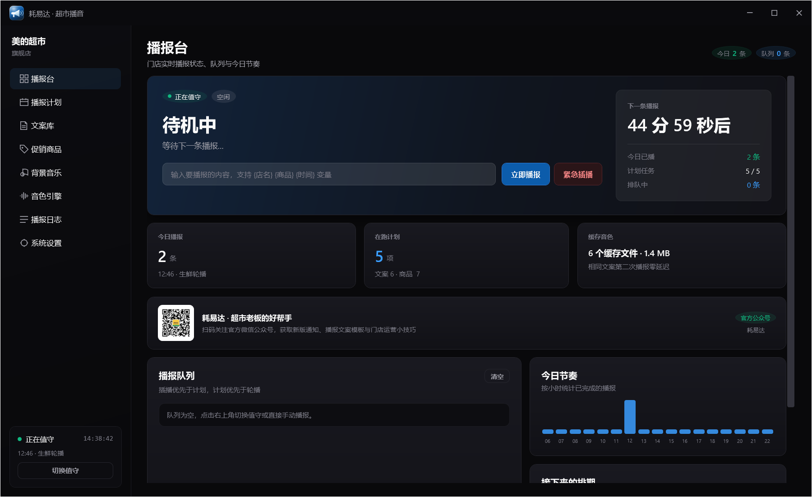
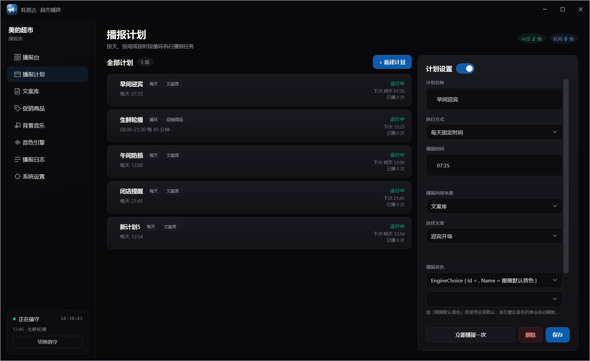
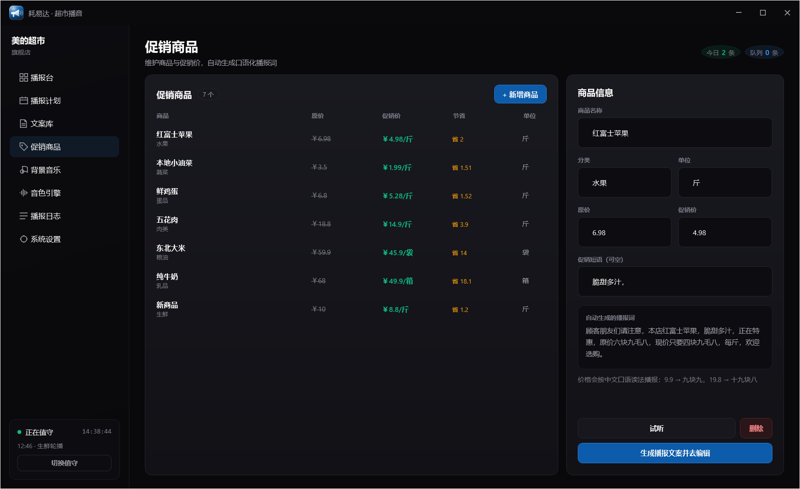
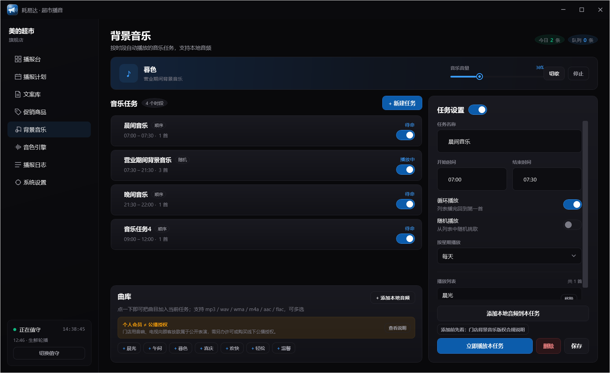
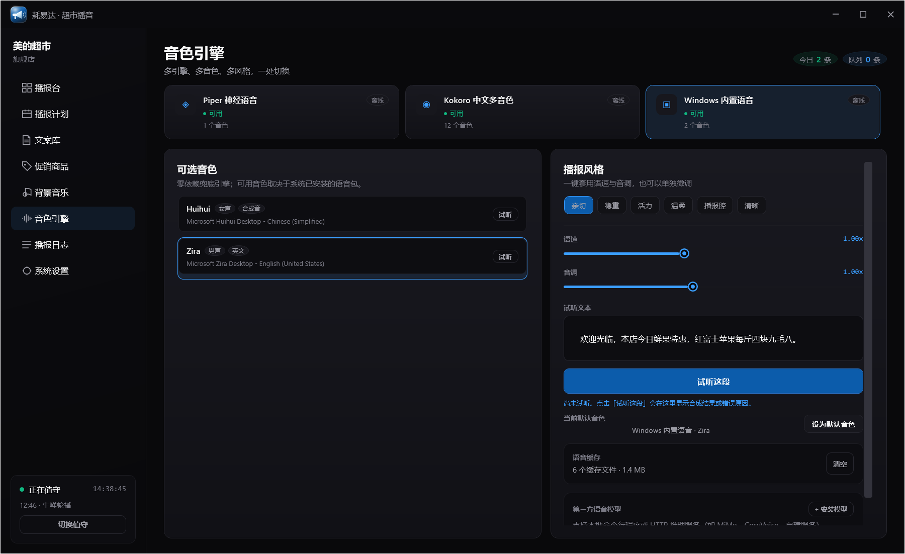
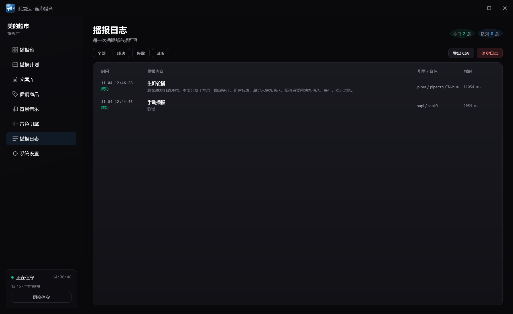

# 耗易达 · 超市播音软件

面向社区超市 / 生鲜店的 Windows 桌面播音台：定时播报、促销轮播、紧急插播、**分时段背景音乐**、多引擎语音。

> 原创实现。未使用任何第三方超市播音软件的代码、资源、字体或音频；功能对标仅发生在产品层面。
> 界面设计规范取自 GitHub 开源项目 [awesome-design-skills](https://github.com/bravet/awesome-design-skills) 的 `dashboard` 设计系统（MIT）。



## 八个模块

| 页面 | 能力 |
| --- | --- |
| 播报台 | 运行状态、下一条倒计时、今日条数、手动播报、紧急插播（顶掉当前与队列）、实时队列、今日节奏图、接下来排期 |
| 播报计划 | 每天 / 每周 / 时段循环 / 单次；生效时段、优先级、单条音量、启停 |
| 文案库 | 分类、搜索、变量模板、渲染预览、试听 |
| 促销商品 | 商品/原价/促销价/单位/促销语；一键生成口语播报词 |
| **背景音乐** | 按时间段的音乐任务（晨间/营业/晚间）、顺序或随机、循环、音量、切歌；**内置 3 首原创曲** + 自定义添加本地音频（可多选） |
| 音色引擎 | Piper（内置）/ SAPI / Edge 三引擎；6 种风格预设；真实变调；**第三方模型安装（命令行 / HTTP）**；试听与缓存 |
| 播报日志 | 成功/失败/试听、引擎与音色、耗时、CSV 导出 |
| 系统设置 | 门店信息、营业时间、BGM、中文数字读法、数据目录、关注官方公众号 |

### 播报的两个中文细节

- **金额口语化**：`6.98 → 六块九毛八`、`6.90 → 六块九`、`0.90 → 九毛`、`12.00 → 十二块整`、`6.05 → 六块零五分`。
- **变量为空时收拾标点**：不会播出“，，每斤”。

## 背景音乐

参考同类软件的做法，BGM 不是“选一个文件”，而是**音乐任务**：

| 任务 | 时段 | 模式 | 曲目 |
| --- | --- | --- | --- |
| 晨间音乐 | 07:00–07:30 | 顺序循环 | 晨光 |
| 营业期间背景音乐 | 07:30–21:30 | 随机循环 | 午间 / 晨光 / 暮色 |
| 晚间音乐 | 21:30–22:00 | 顺序循环 | 暮色 |

- 三首内置曲为**本项目用 `tools/make_music.py` 合成**（无第三方采样、无版权风险），可无缝循环。
- 「+ 添加本地音频」支持一次多选 `mp3 / wav / wma / m4a / aac / flac`，加入当前任务即可。
- 人声播报时 BGM 自动压低（闪避），播完自动恢复。
- 「添加本地音频」旁固定一条**公播授权提醒**（个人会员 ≠ 公播授权），一键打开合规说明弹窗：法条、三个误区、7000 元判例、三步合规与官方申请入口。

## 语音引擎

| 引擎 | 许可 | 离线 | 状态 |
| --- | --- | --- | --- |
| [Piper](https://github.com/rhasspy/piper) + `zh_CN-huayan-medium` | MIT | 是 | 默认；RTF ≈ 0.14 |
| Windows SAPI5 | 随 Windows | 是 | 零依赖兜底 |
| ~~edge-tts~~ | — | 否 | **已移除**：国内网络被 403，且属在线非免费服务，按产品策略不启用 |

**一个音色怎么变出多种“调调”**：Piper 生成时先按 `r` 倍拉长，音频再按 `r` 倍重采样，净效果是**语速不变、音调改变**（低沉 / 标准 / 清亮），配合 6 种风格预设与语速微调，同一个模型能有明显不同的听感。

更完整的开源 TTS 对比、许可与接入方式见 [docs/tts-open-source.md](docs/tts-open-source.md)。

## 快速开始

```powershell
cd src/Haoyida.App
dotnet run                      # 需要 .NET 10 SDK

Haoyida.exe --selftest          # 端到端自检（引擎 + 合成 + 中文金额读法）
Haoyida.exe --shots D:\shots    # 8 个页面渲染成 PNG
Haoyida.exe --logo app.ico      # 从矢量 Logo 生成多尺寸图标
```

发布产物在 `dist/Haoyida/`，双击 `Haoyida.exe` 运行（目标机需 **.NET 10 Desktop Runtime**）。

## 目录结构

```
haoyida/
├─ src/Haoyida.App/
│  ├─ Core/          # 模型、存储、调度、播放、播报引擎、音乐服务、模板、中文数字
│  ├─ Tts/           # ITtsEngine + Piper/SAPI/Edge 适配器 + WAV 变调工具
│  ├─ ViewModels/    # MainViewModel（含 Music 分部类）
│  ├─ Views/         # 8 个页面 + 喇叭 Logo
│  ├─ Themes/        # design token 与控件模板
│  ├─ Assets/        # 图标、公众号二维码、3 首内置 BGM
│  └─ Program.cs     # 带异常落盘的入口
├─ tools/            # 曲库合成、TTS sidecar
├─ docs/             # 设计规范、TTS 选型、合规、部署
└─ dist/Haoyida/     # 发布产物（含 Piper 运行时）
```

## 关键设计取舍

1. **零第三方 NuGet 依赖**：构建机的 .NET TLS 栈异常时仍可离线编译；语音走 COM/进程调用，播放走 `MediaPlayer`，存储走 `System.Text.Json`。
2. **合成缓存**：同一句话第二次播报瞬时完成（实测 0–12 ms）。
3. **在线失败自动回落**：Edge 断网或 403 时改用 SAPI，营业不中断。
4. **Piper 中文路径规避**：`piper.exe` 遇到中文路径会崩（`0xC0000409`），程序自动把运行时搬到 `C:\ProgramData\Haoyida\runtime\piper`，产物先写 ASCII 暂存区。

## 已知限制

- 目标机需 .NET 10 Desktop Runtime（未做 self-contained 打包）。
- Piper 中文仅 1 个女声；需要更多真人音色请接入 Edge 或自训模型（见 TTS 文档）。
- 未实现开机自启与托盘常驻。

## 文档

- [第三方语音模型接入](docs/third-party-models.md)\n- [设计规范落地](docs/design-system.md) · [开源 TTS 选型](docs/tts-open-source.md) · [合规说明](docs/compliance.md) · [构建与部署](docs/build-deploy.md)

---

## 开源许可

本仓库代码以 **MIT** 许可开源，版权归 **深圳市耗易达供应链管理有限公司**。详见 [LICENSE](LICENSE)。

内置语音能力依赖的第三方组件遵循各自许可：

| 组件 | 许可 |
| --- | --- |
| [Piper](https://github.com/rhasspy/piper) + 中文音色 | MIT |
| [Kokoro-82M v1.1-zh](https://huggingface.co/hexgrad/Kokoro-82M-v1.1-zh) | Apache-2.0 |
| [awesome-design-skills](https://github.com/bravet/awesome-design-skills)（dashboard 设计规范） | MIT |
| .NET / WPF | MIT |

语音模型权重体积较大（合计约 500MB），**不纳入仓库**，请参考 [构建与部署](docs/build-deploy.md) 自行下载。

## 界面截图

| 播报台 | 播报计划 |
| --- | --- |
|  |  |

| 促销商品 | 背景音乐 |
| --- | --- |
|  |  |

| 音色引擎 | 播报日志 |
| --- | --- |
|  |  |

## 项目结构

```
src/Haoyida.App      主程序（WPF / .NET 10，零第三方 NuGet 依赖）
src/Haoyida.Setup    Windows 安装程序（自绘界面，单文件 exe）
tools/               曲库合成、宣传片渲染、TTS sidecar
docs/                设计规范、TTS 选型、部署、合规、方言方案
marketing/           公众号文案、配图提示词、9:16 宣传片
```

## 相关文档

[设计规范](docs/design-system.md) · [TTS 选型](docs/tts-open-source.md) · [第三方模型接入](docs/third-party-models.md) · [方言方案](docs/dialects.md) · [合规说明](docs/compliance.md) · [构建部署](docs/build-deploy.md)
